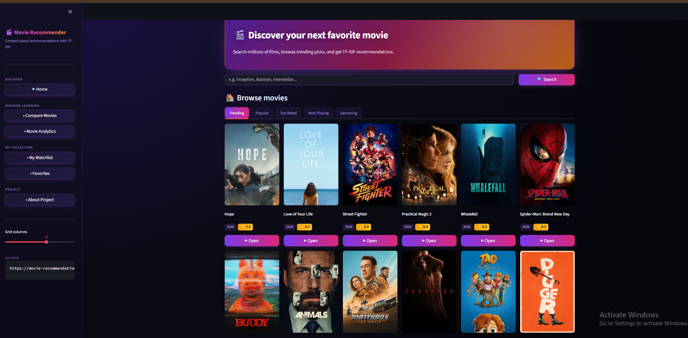
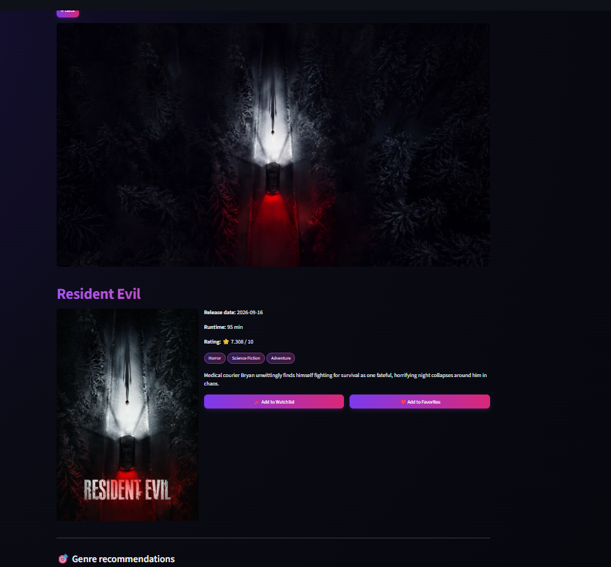
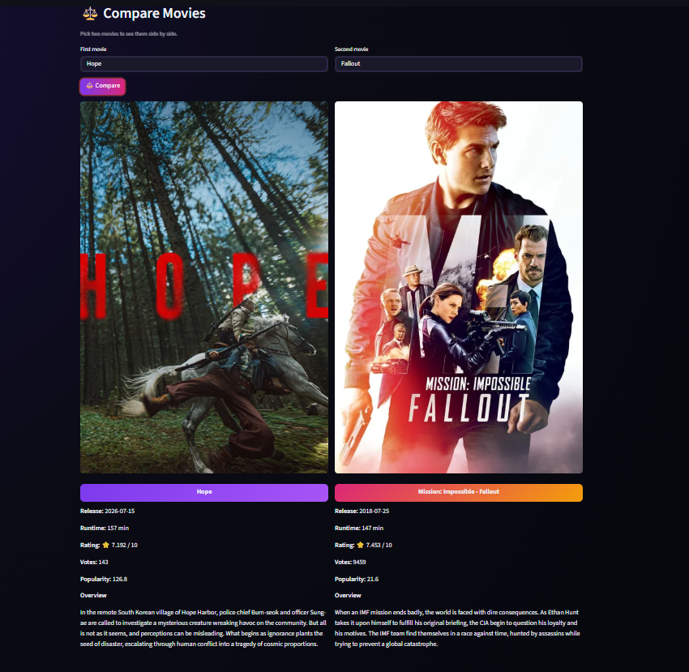
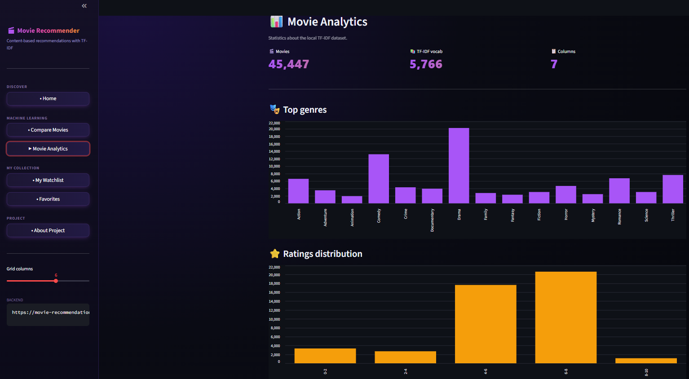

# 🎬 Production-Grade Content-Based Movie Recommendation Engine

An end-to-end, production-oriented content-based recommendation system architecture. This repository demonstrates the complete lifecycle of a Machine Learning system—from exploratory data analysis (EDA) and Natural Language Processing (NLP) vectorization to API serving via FastAPI, persistence via SQLite, and UI deployment via Streamlit.

---

## 🌐 Live System Architecture & Deployment

The application is deployed as a decoupled microservice architecture on Render.

| Layer             | Component            | Live Endpoint                                                                                                    |
| :---------------- | :------------------- | :--------------------------------------------------------------------------------------------------------------- |
| **Frontend UI**   | Streamlit Web App    | [movie-recommendation-app-sfxg.onrender.com](https://movie-recommendation-app-sfxg.onrender.com)                 |
| **Backend API**   | FastAPI Service      | [movie-recommendation-api-7910.onrender.com](https://movie-recommendation-api-7910.onrender.com)                 |
| **API Reference** | OpenAPI / Swagger UI | [movie-recommendation-api-7910.onrender.com/docs](https://movie-recommendation-api-7910.onrender.com/docs)       |
| **Repository**    | GitHub Source Code   | [github.com/Kazi-Sadman/Movie-Recommendation-System](https://github.com/Kazi-Sadman/Movie-Recommendation-System) |

> **Note on Infrastructure Cold-Starts:** The backend service is hosted on Render's free tier instance and spins down after 15 minutes of inactivity. Initial cold-start latency ranges between 30–60 seconds; automatic client retry logic is implemented in the frontend adapter.

---

## 📸 System Interface & Analytics

Ensure your PNG screenshot assets are placed inside the `docs/images/` directory matching the names below:

### 1. Discovery & Search Pipeline (`home.png`)

Real-time filtering interface consuming TMDB endpoints and dynamic recommendation streams.



### 2. Feature Metadata & Item-to-Item Similarity (`details.png`)

Detailed metadata extraction alongside TF-IDF content recommendations.



### 3. Latent Feature Comparison (`compare.png`)

Comparative analysis view evaluating metadata across target vector profiles.



### 4. Corpus Analytics & TF-IDF Vector Distribution (`analytics.png`)

Exploratory insights showcasing top genre frequency distributions and vocabulary density.



---

## 🧠 Machine Learning & Vectorization Pipeline

### Mathematical Overview

The recommendation engine uses **Term Frequency-Inverse Document Frequency (TF-IDF)** vectorization combined with **Cosine Similarity** metric computation over a high-dimensional document space.

1. **Document Synthesis:**
   For each item $d_i$ in dataset $D$, a corpus document is generated by concatenating sanitized metadata:
   $$d_i = \text{Overview} \oplus \text{Genres} \oplus \text{Tagline}$$

2. **Text Normalization & Lemmatization:**
   - Lowercasing & punctuation removal via regex.
   - Stop-word filtration (NLTK English corpus).
   - WordNet Lemmatization for syntactic reduction.

3. **Vector Space Construction:**
   The document-term matrix $X \in \mathbb{R}^{N \times M}$ is transformed where $N = 45,447$ movies and $M = 5,766$ vocabulary features:
   $$\text{TF-IDF}(t, d, D) = \text{TF}(t, d) \times \text{IDF}(t, D)$$
   $$\text{IDF}(t, D) = \log \left( \frac{1 + |D|}{1 + |\{d \in D : t \in d\}|} \right) + 1$$

4. **Cosine Similarity Computation:**
   Pairwise similarity scores between query vector $\mathbf{u}$ and target vector $\mathbf{v}$ are calculated using the dot product over $L_2$-normalized vectors:
   $$\text{Sim}(\mathbf{u}, \mathbf{v}) = \cos(\theta) = \frac{\mathbf{u} \cdot \mathbf{v}}{\|\mathbf{u}\|_2 \|\mathbf{v}\|_2}$$

```text
[ Raw Corpus ] ──► [ Text Sanitization ] ──► [ TF-IDF Vectorizer ] ──► [ Sparse Matrix: 45,447 × 5,766 ]
                                                                                   │
[ Top-N Item Matches ] ◄── [ Index Ranker ] ◄── [ Cosine Similarity Engine ] ◄─────┘
```

---

## 🛠 Tech Stack & Dependencies

- **Machine Learning & Data Processing:** `scikit-learn`, `pandas`, `numpy`, `nltk`
- **Backend API Framework:** `FastAPI`, `Uvicorn`, `Pydantic`
- **Frontend Dashboard:** `Streamlit`
- **Database & Persistence:** `SQLite3` (Watchlist, Favorites, User interactions)
- **External Data Source:** `TMDB REST API`
- **Containerization & Deployment:** `Render`, `Python 3.10`

---

## 📂 Project Architecture

```text
Movie-Recommendation-System/
├── app.py                      # Streamlit UI application engine
├── main.py                     # FastAPI web service & endpoint router
├── database.py                 # SQLite ORM / Data Access Layer (DAL)
├── movies.db                   # SQLite transactional storage
├── requirements.txt            # Environment dependency manifest
├── runtime.txt                 # Deployment runtime environment declaration
├── .env                        # Local environment variables (TMDB API Key)
├── .gitignore                  # Git exclusion policy
├── README.md                   # System documentation
│
├── data/                       # Raw datasets
│   └── processed/              # Serialized ML artifacts
│       ├── df.pkl              # Processed Metadata DataFrame
│       ├── indices.pkl         # Reverse mapping series (Title -> Index)
│       ├── tfidf.pkl           # Trained TfidfVectorizer instance
│       └── tfidf_matrix.pkl    # Sparse TF-IDF Term-Document Matrix
│
├── notebooks/                  # Training & EDA Pipeline
│   └── movies.ipynb            # Notebook: Data Preprocessing, Vectorization, Validation
│
└── docs/                       # System Design Documentation & Assets
    ├── images/                 # System UI Screenshots (PNG format)
    │   ├── home.png
    │   ├── details.png
    │   ├── compare.png
    │   └── analytics.png
    ├── 01_PRD.md
    ├── 02_TRD.md
    ├── 03_APP_FLOW.md
    ├── 04_DESIGN_BRIEF.md
    ├── 05_DATABASE_SCHEMA.md
    └── 06_IMPLEMENTATION_PLAN.md
```

---

## 🔌 API Specification & Schema

The backend provides a RESTful interface compliant with the OpenAPI 3.0 specification.

| Method   | Endpoint                     | Description                                | Query / Payload Parameters                                                |
| :------- | :--------------------------- | :----------------------------------------- | :------------------------------------------------------------------------ |
| `GET`    | `/health`                    | Liveness & Readiness probe                 | None                                                                      |
| `GET`    | `/home`                      | Fetch catalog feeds by category            | `category`: `trending`, `popular`, `top_rated`, `now_playing`, `upcoming` |
| `GET`    | `/tmdb/search`               | Remote TMDB query proxy                    | `query` (str)                                                             |
| `GET`    | `/movie/id/{id}`             | Retrieve metadata for specific TMDB ID     | `id` (int)                                                                |
| `GET`    | `/recommend/genre`           | Fetch genre-filtered item recommendations  | `tmdb_id` (int)                                                           |
| `GET`    | `/recommend/tfidf`           | Execute TF-IDF cosine similarity search    | `title` (str)                                                             |
| `GET`    | `/analytics`                 | Retrieve corpus analytics & vector metrics | None                                                                      |
| `POST`   | `/collection/add`            | Insert item into user persistence          | `{ tmdb_id, title, poster_path, kind }`                                   |
| `GET`    | `/collection/list`           | Query saved collections                    | `kind`: `watchlist` or `favorite`                                         |
| `DELETE` | `/collection/remove`         | Remove item from SQLite store              | `tmdb_id` (int), `kind` (str)                                             |
| `POST`   | `/collection/toggle-watched` | Update item state                          | `tmdb_id` (int), `watched` (bool)                                         |

---

## 💻 Local Environment Setup

### 1. Repository Cloning & Environment Setup

```bash
git clone https://github.com/Kazi-Sadman/Movie-Recommendation-System.git
cd Movie-Recommendation-System

# Initialize virtual environment
python -m venv .venv

# Activate Virtual Environment
# Windows:
.venv\Scripts\activate
# macOS / Linux:
source .venv/bin/activate

# Install exact dependencies
pip install --upgrade pip
pip install -r requirements.txt
```

### 2. Configure Environment Variables

Create a `.env` file in the root directory:

```env
TMDB_API_KEY=your_tmdb_api_key_here
DB_PATH=movies.db
```

### 3. Launch Backend API Server

```bash
uvicorn main:app --host 127.0.0.1 --port 8000 --reload
```

- API Instance: `http://127.0.0.1:8000`
- Interactive OpenAPI Docs: `http://127.0.0.1:8000/docs`

### 4. Launch Frontend Interface

In a separate terminal (with virtual environment active):

```bash
streamlit run app.py
```

- Streamlit Web App: `http://localhost:8501`

---

## 🗄 Storage Architecture & Persistence

User interactions (Watchlist and Favorites) are maintained via an embedded SQLite instance:

- **Database Path Configuration:** Controlled via `DB_PATH` environment variable.
- **Ephemeral Storage Strategy:** For free-tier container hosting (e.g., Render), persistent disk mounts (e.g., `/var/data/movies.db`) must be configured to prevent database resets on container redeployment.

---

## 👨‍💻 Author & Contact

**Kazi Sadman Zahin**  
_Computer Science & Engineering Student | ML & Systems Developer_

- **GitHub:** [@Kazi-Sadman](https://github.com/Kazi-Sadman)
- **Project Repository:** [Movie-Recommendation-System](https://github.com/Kazi-Sadman/Movie-Recommendation-System)
